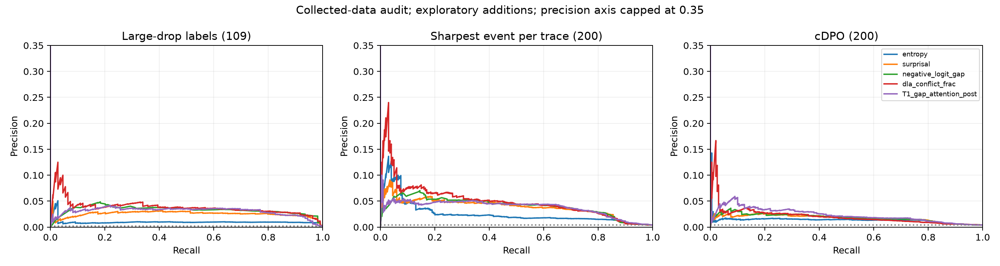

**There is a useful ranking signal, especially for large drops: how strongly the model preferred another token over the emitted token. Exact token detection remains noisy, and cDPO is substantially harder.**

This analysis uses the completed Qwen2.5-7B / MATH500 run: 300 traces, 110 problems, 71,874 labeled positions, including 49,399 positions in 200 wrong traces. It adds a CPU-only audit of the saved features; no rollouts, feature extraction, original-label changes, or original-result overwrites. The conclusions are exploratory on this selected dataset.

**The target distinction changes the headline result.**

The task calls `is_crit_drop` the sharpest-drop target, but `ctlabel/labels.py` defines it as any wrong-trace token with drop >= 0.3 and a positive lower confidence bound. The actual per-trace event is `traces.crit_drop`. These are different populations:

| Target | Positive tokens | Positive traces | Positive problems | Positives below median entropy |
|---|---:|---:|---:|---:|
| A: saved `is_crit_drop` (large-drop label) | 109 | 96 | 73 | 1 |
| S: token at `traces.crit_drop` (sharpest event) | 200 | 200 | 109 | 17 |
| C: `is_crit_cdpo` | 200 | 200 | 109 | 26 |

A and S overlap at 96 tokens; A and C at 27; S and C at 34. The 0.95–0.96 AUROCs in the original report describe A, not all 200 sharpest events. S below is a separately named sensitivity analysis; the original labels and negative pools remain unchanged.

**The best cheap scalar is the signed output gap.**

For the emitted token y, define

`score = max_{v != y} logit(v) - logit(y) = log[p(best alternative) / p(y)]`.

Large positive values mean that the decoder sampled a token the model preferred less than an alternative. This is available as the token is emitted, using the already-computed logits and chosen token. It is not advance prediction before the token is selected. Use the two highest logits and the chosen token's logit to compute it directly in a decoder.

A: large-drop labels, versus all other wrong-trace positions (prevalence 0.221%):

| Signal | AUROC [95% CI] | AUPRC | False alarms / 1,000 negatives at 50% recall |
|---|---:|---:|---:|
| Entropy | 0.877 [0.856, 0.896] | 0.0101 | 119.0 |
| Chosen-token surprisal | 0.949 [0.932, 0.962] | 0.0259 | 35.8 |
| Alternative-minus-chosen logit gap | 0.957 [0.941, 0.969] | 0.0333 | 29.7 |
| DLA conflict fraction | 0.959 [0.943, 0.970] | 0.0392 | 29.3 |
| Output-feature logistic model (fixed C) | 0.944 [0.916, 0.964] | 0.0312 | 28.7 |

The gap improves AUROC over surprisal by **0.0083 [0.0050, 0.0112]** in a paired problem bootstrap. This improvement is small but consistent. Entropy is distinctly weaker: among the highest-entropy quintile, entropy itself has A AUROC 0.500, while the gap retains 0.828. The chosen action matters more than distribution-wide uncertainty.

S: actual sharpest event in each wrong trace (prevalence 0.405%):

| Signal | AUROC [95% CI] | AUPRC | False alarms / 1,000 negatives at 50% recall |
|---|---:|---:|---:|
| Entropy | 0.834 [0.804, 0.863] | 0.0261 | 105.9 |
| Chosen-token surprisal | 0.876 [0.843, 0.906] | 0.0393 | 46.4 |
| Alternative-minus-chosen logit gap | 0.878 [0.846, 0.909] | 0.0406 | 44.8 |
| DLA conflict fraction | 0.876 [0.843, 0.906] | 0.0505 | 44.2 |
| Output-feature logistic model (fixed C) | 0.889 [0.860, 0.915] | 0.0400 | 43.3 |

C: cDPO token (prevalence 0.405%):

| Signal | AUROC [95% CI] | AUPRC | False alarms / 1,000 negatives at 50% recall |
|---|---:|---:|---:|
| Entropy | 0.787 [0.752, 0.817] | 0.0138 | 136.1 |
| Chosen-token surprisal | 0.805 [0.771, 0.837] | 0.0174 | 115.7 |
| Alternative-minus-chosen logit gap | 0.805 [0.771, 0.838] | 0.0186 | 107.3 |
| DLA conflict fraction | 0.787 [0.750, 0.820] | 0.0210 | 121.3 |
| Output-feature logistic model (fixed C) | 0.820 [0.787, 0.851] | 0.0220 | 95.2 |

For cDPO, gap and surprisal have effectively identical AUROC. A modest output-feature model reaches 0.820, but this is not high-precision event detection. In the original matched-negative comparisons, surprisal AUROC is 0.805 against all other tokens, but only 0.615 against benign forks; for A those values are 0.949 and 0.805. Thus the scores partly distinguish ordinary predictable continuation from branching, rather than reliably identifying which branch will be damaging.

**Most of the strongest DLA result is already an output-level quantity.**

`dla_total` equals the chosen-minus-alternative logit gap by construction. Its negative and the output-derived gap have rank correlation **0.999857** here. Calling this an independent hidden-state discovery would overstate the result. The tiny differences arise from the float32 residual/head path versus bf16 output logits and reconstruction from rounded saved probabilities. The audit reconstructs the alternative probability using `pmax - margin12` when y is top-1; cancellation at extreme confidence can create large absolute errors in that low-risk tail. A live implementation should use logits directly.

DLA conflict fraction is a related but distinct normalization. If positive contributions sum to P and the magnitude of negative contributions is N, then

`conflict_frac = N/(P+N) = 0.5 * [1 - dla_total/(P+N)]`.

This identity holds to 1.8e-7 in the saved features. The score crosses 0.5 exactly when the alternative has the larger logit; its denominator contains extra block-level information. Its AUROC gain over the output gap for A is only **0.0014 [-0.0011, 0.0037]**, but its AUPRC gain is **0.0059 [0.0002, 0.0193]**. For S the AUPRC gain is **0.0099 [0.0020, 0.0260]**. This is a modest precision-ranking lead worth retaining for further validation, not evidence that all of the DLA signal is novel. These follow-up comparisons are exploratory and not corrected for selection or multiplicity.

The selected-token disagreement explains much of the separation:

| Target | Positive tokens that are not argmax | Other wrong-trace tokens that are not argmax | Gap AUROC within non-argmax tokens | DLA-conflict AUROC within non-argmax tokens |
|---|---:|---:|---:|---:|
| A | 81.7% | 5.83% | 0.560 | 0.586 |
| S | 62.0% | 5.77% | 0.561 | 0.589 |
| C | 35.0% | 5.88% | 0.525 | 0.563 |

Surprisal's A AUROC within non-argmax tokens is 0.485. In other words, identifying a disfavored sampled token is much easier than separating harmful and harmless disfavored samples. The event-aligned DLA plot also shows a narrow spike at the event, with little separation beforehand; it supports detection at emission rather than a long advance warning.

**False alarms constrain practical usefulness.**

The ranking tables choose a threshold from the evaluation scores to report 50% recall. As a stricter operating-point check, I selected each fixed-form score's threshold using only the training problems in five grouped folds, then applied it unchanged to held-out problems:

| Target, output-gap rule | Held-out recall | Precision on wrong traces | False alarms / 1,000 other wrong-trace tokens | Alarms / 1,000 right-trace tokens |
|---|---:|---:|---:|---:|
| A | 52.3% | 3.47% | 32.1 | 30.6 |
| S | 50.0% | 4.38% | 44.4 | 41.5 |
| C | 50.5% | 1.80% | 112.0 | 104.8 |

For A, the training-selected gap thresholds ranged from 0.625 to 0.750 logits: the best alternative was roughly twice as probable as the sampled token. This is a useful candidate alert rule, but these are not portable calibrated thresholds. On the combined wrong-plus-right population its AUPRC drops from 0.0333 to 0.0234 because positives become rarer; AUROC remains 0.958. Right-trace alerts are not necessarily harmful decisions, but they are false positives for this target.

For offline localization, the top-five output-gap positions contain at least one A-positive in 50% of the 96 traces with an A-positive; they contain the S event in 34% of all 200 wrong traces, and cDPO in 16.5%. Top-one hit rates are 8.3%, 7.5%, and 5.5%, respectively. These retrospective rankings do not use an online threshold and should not be presented as online recall.

**What the other feature families contribute.**

- **Phi-Align:** no useful standalone A detector in these results. Reference-centered token Phi has AUROC 0.505, window-64 Phi 0.531, and window delta 0.547; none passes the original screen's FDR threshold. The best raw variant reaches only 0.582 pre / 0.588 post. Adding five final-layer Phi features to the exploratory output-plus-gap model gives no clear gain. The reference-Phi event plot largely overlaps its right-trace control.
- **Attention:** layer 25, head 3's post-emission response attention is the strongest reported scalar (A AUROC 0.816 with negative sign), below the output gap. Adding this one selected head to the small output model gives no clear gain. The original fold-selected top-eight-head model does improve A AUROC over T1 by 0.007 [0.001, 0.015]; this is the stronger evidence for a small attention contribution. Measured attention overhead was about 14.9 ms/token over a 22.0 ms/token baseline.
- **Full derived-feature models:** the original T1+T3 pre model reaches A AUROC 0.962 and AUPRC 0.056, with 19.5 false alarms/1,000 negatives at 50% recall. The all-feature post model reaches AUPRC 0.078 and 11.2 false alarms/1,000. These precision gains are worth further investigation, although AUROC gains over T1 mostly have intervals crossing zero. The follow-up's fixed-C ablations do not establish which individual features explain those full-model gains.
- **Raw hidden-state probes:** best original A AUROC is about 0.796 (layer 28 pre), and best cDPO AUROC about 0.772 (layer 20 pre); both trail output features.
- **Waiting:** the original delay curves show no AUROC improvement from waiting 4/16/64 tokens. Post-emission features can improve precision, but additional delay has no clear benefit in the reported ranking results.
- **Graded drop prediction:** original Spearman correlations are tiny (best scalar about 0.031). Strong separation of rare large drops does not translate into useful prediction of the signed drop at every position.

**Interpretation and next detector to test.**

Start with the **alternative-minus-chosen logit gap**, keep **surprisal** as the reference baseline, and retain **DLA conflict fraction** as an optional candidate for better precision near the top of the ranking. The evidence favors a sampled-token disagreement signal. It does not yet support a broadly reliable detector of semantic criticality, especially among non-argmax choices or for cDPO. To assess added representation information, compare against the output gap and evaluate on non-argmax / benign-fork negatives, alongside precision and false-alarm budgets. Validate any selected feature combination on new problems before choosing deployment thresholds. Phi-Align is not a priority based on this run.

**Audit details and limits.**

The follow-up used five problem-grouped folds (seed 0), fixed C=0.1 logistic regression, and training-only imputation and scaling. Scalar scores require no fitting. CIs use 1,000 paired problem bootstrap resamples (seed 42), conditional on the saved out-of-fold predictions; they do not refit models or account for feature discovery on this dataset. Subgroup and localization tables are descriptive point estimates. Original-report models use their original C-selection procedure, so they are distinguished from the fixed-C follow-up above.

Exhaustive-value preflight checks passed. The audit asserted disjoint train/test problem IDs and checked every overall AUROC and average-precision result against scikit-learn to 1e-10. Removing engine-mismatch positions leaves the main findings intact (gap AUROC A 0.959, S 0.876, C 0.805). The original low-entropy A model comparisons depend on **one positive in one problem** and cannot support claims about detecting confident mistakes; bootstrap intervals that look narrow there do not solve the missing-positive diversity.

Two reporting/method details in the original pipeline need care: `pmax` is used with the wrong risk direction in the baseline table (use **minus pmax**, giving A AUROC 0.896 rather than 0.104); and preprocessing/head selection is fitted on the outer training fold before `LogisticRegressionCV` performs inner C-selection. Outer test problems remain held out, but preprocessing and supervised head selection are not refitted inside each inner split. The fixed-C follow-up avoids that inner-selection issue. No original pipeline code was changed.

[Reproducible analysis](../analyze_signals.py) · [Score estimates and CIs](signals_audit/scores.csv) · [Paired differences](signals_audit/gains.csv) · [Threshold calibration](signals_audit/thresholds.csv) · [Subgroups](signals_audit/subgroups.csv) · [Localization](signals_audit/trace_localization.csv) · [Audit metadata](signals_audit/audit.json) · [Saved predictions](signals_audit/predictions.parquet)

Reproduce from the repository root with `/pscratch/sd/a/arafspn/venvs/ctlabel/bin/python -m analysis.analyze_signals`.
